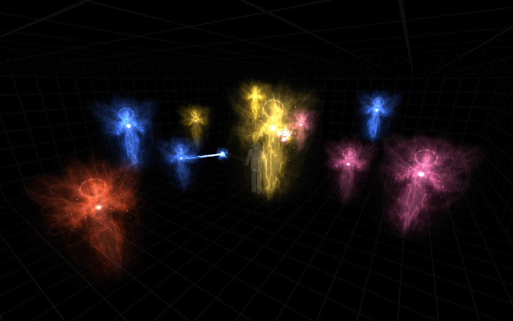
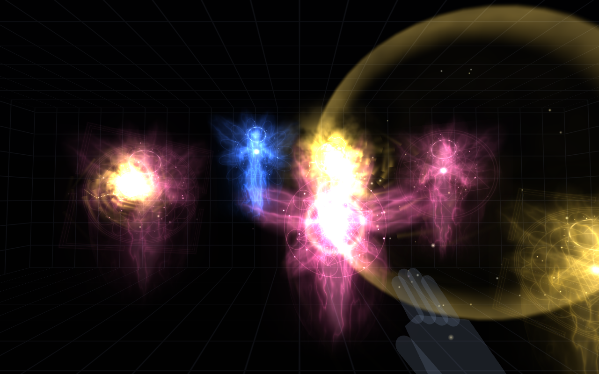
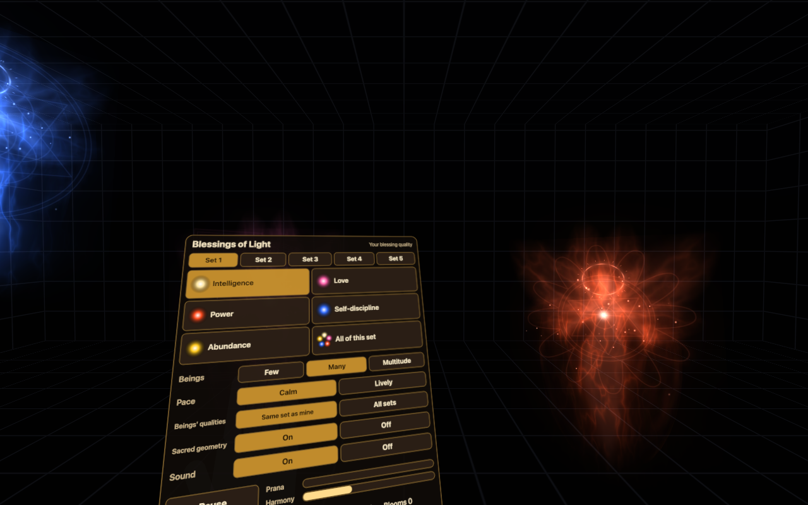
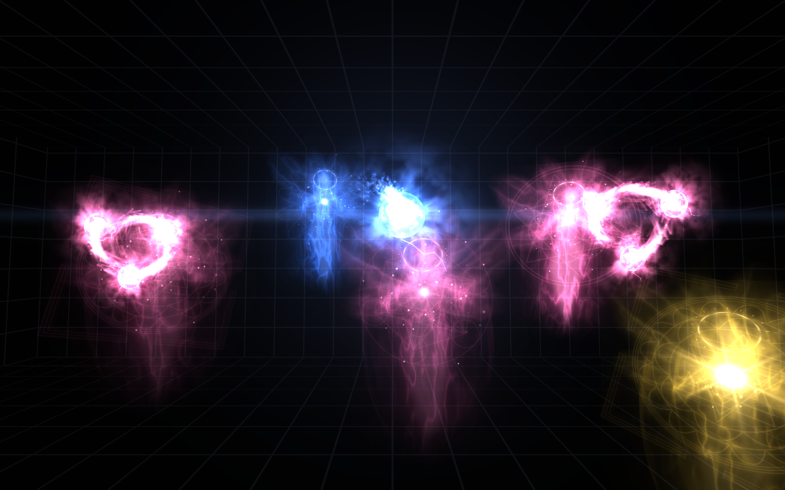
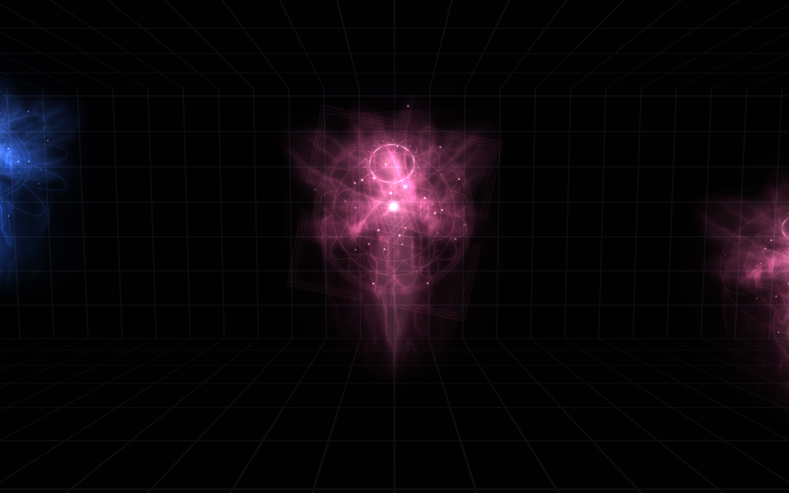

# Blessings of Light AR

A peaceful mixed-reality (passthrough) game for **Meta Quest 3**. Beings of light float all around you, a full 360 degrees, and keep sending you blessings as living balls of plasma. You bless them back with your hands. There is no damage, no health and no losing: only giving and receiving.

Hands only, no controllers. The qualities and their colours come from Puja VR, and the look and stack follow Energy Flow AR.

**Open it:** https://utubevsr-sketch.github.io/blessings-of-light-ar/



## How to play on Quest 3

1. Put on the headset and open the **Meta Quest Browser**.
2. Go to the address above and tap **Enter AR**. Allow hand tracking when asked. Space Setup is **not** needed.
3. Put the controllers down. Hand tracking turns on by itself.
4. The beings fade in around you. Turn around: they are behind and above you too.

### Receiving

Every few seconds one being gathers light into its core (it brightens and you hear a rising tone), then sends a ball of plasma toward your heart. It travels on a gentle curve, slowly enough to watch it come. When it arrives it passes into your body: a soft flare of your aura in that colour, a little crackle of lightning, a chime, and the quality's name floats in front of you ("Joy received").

**Catch it:** hold an **open palm** toward a blessing that is coming. It bends into your palm, orbs of light run up your forearm, your hand glows, and you get more Prana ("Joy caught").


### Giving

Your blessings are in the quality you choose in the menu. "All of this set" gives in all the set's colours.

- **Point and pinch:** point your hand at a being (a ring shows which one; it helps your aim) and pinch thumb and index finger. A ball of plasma flies to it.
- **Palm push:** hold an open palm toward the beings and push it forward quickly. A wide wave of blessing goes out and touches every being in that direction.
- **Anjali (Namaste):** press both palms together in front of your chest and hold them still for about a second. A ring of light gathers at your hands, then a ring of blessing goes out in every direction and touches every being at once. With full Prana it is a strong blessing and uses up the Prana; without it you send a gentle, softer ring.

When a being is blessed it brightens a step, opens its veils of light, spins its halo faster and sings its own note. It often blesses you back soon after. After **three** blessings it **ascends**: a column of light, a starburst, and it rises and dissolves into light. A new being appears somewhere else a few seconds later.




### Meters

Two small glowing arcs sit on your **left wrist** (look at the inside of your wrist):

- **Prana** (inner arc, in your colour): fills when you receive a blessing, more when you catch one. It pulses when full. Anjali uses it.
- **Harmony** (outer arc, gold): rises when your giving and receiving are in balance and when you bless many different beings. It settles slowly when nothing happens.

At **100% Harmony** comes the **Harmony Bloom**: every being glides into a ring around you at eye level, a large Flower of Life with a Sri Yantra at its heart forms on the floor around you, and they all shower you with light for about 8 seconds, with a choir-like swell. Then everything returns, and Harmony starts again at 50%.


### The menu (on your left hand)

**Turn your left palm toward your face** and hold it for a moment: the menu appears just above your left hand. Turn the palm away and it fades. Press buttons with your right hand: point and pinch, or poke a button with your right index fingertip. A short hint reminds you of this when you first enter.

- **Set 1 to Set 5**, the qualities with their colours, and **All of this set**: the quality of your blessings.
- **Beings:** Few (6), Many (10, the default) or Multitude (16).
- **Pace:** Calm or Lively.
- **Beings' qualities:** Same set as mine, or All sets (new beings take this).
- **Sacred geometry:** On or Off.
- **Sound:** On or Off.
- **Pause / Resume:** the beings stop sending blessings while paused.
- The Prana and Harmony bars and the counters: blessings given, received, caught, beings ascended and Harmony Blooms.

Your choices are saved for next time.



## What you see

- **Beings of light:** a white-hot core inside a soft, roughly human radiance of flowing light, arms open in blessing, a robe of light that thins into flame, a slowly turning halo ring, six breathing veils of light like wings or petals, orbiting motes, layered shells of light and a faint yantra behind (Sri Yantra, Anahata, Metatron's Cube or the Seed of Life). Each being carries one quality and its colour. They float 2.5 to 4.6 m away, from knee height to well above your head, slowly circling and bobbing, always facing you.
- **Plasma blessings:** a dense, churning ball of plasma with a white-hot core and a turbulent corona, lightning filaments wrapped round it, a motion-blur trail and shed sparks. Each quality has its own kind: a single orb, three small orbs spiralling round each other, a slow large sphere, or a quick comet with a long tail.
- **One colour for everything:** every layer of a blessing (corona, trail, lightning, sparks, aura, hand glow, flare, sacred geometry) is tinted in its quality's colour. Only cores go white-hot. Dark colours are lifted and pale ones strengthened so they read over your room, as in Energy Flow.
- Glows are capped near your eyes and the flare never covers more than about a third, so your room always stays visible.




## Sound

A soft drone, a rising tone as a being gathers light, a whoosh as a blessing sets off (you hear where it comes from), a chime when one reaches you, a note for each being you bless (a pentatonic scale, a different note per being), bells for Anjali and ascension, and a choir-like swell for the Harmony Bloom. Sound starts when you tap Enter AR.

## Desktop preview

Open the page in a normal browser. You get a dim stand-in room. Drag to look around, click a being to bless it, and use the keys:

| Key | Does |
| --- | --- |
| P | Palm push toward the middle of the view |
| N | Anjali (both palms together for about a second) |
| C | Hold out an open palm to catch (press again to lower it) |
| M | Show or hide the menu |

The meters show at the lower right. For screenshots and checks:

| URL | Shows |
| --- | --- |
| `?demo` | First person: beings with blessings frozen mid-flight, one being gathering light |
| `?demo=360` | Third person: the beings all around a stand-in person |
| `?demo=being` | Close-up of a being (`&lvl=0..2` how blessed it is, `&wind` gathering light) |
| `?demo=catch` | A stand-in hand catching blessings, orbs running up the forearm |
| `?demo=give` | Your blessings hitting beings, and a palm-push wave |
| `?demo=anjali` | Anjali seen from outside (`&stop=1.0` shows the ring gathering at the hands) |
| `?demo=bloom` | The Harmony Bloom from a third-person view |
| `?demo=menu` | A stand-in left palm turned toward you, showing the menu |
| `?demo=smoke&xrhands` | Smoke test: fake WebXR hand joints and a WebXR 'select' (pinch) go through the same code the headset uses, for pinch, palm push, catch and Anjali. Sets `window.__smoke` |
| `&set=0..4&q=0..4` (`q=-1` all of the set), `&bq=all`, `&n=0..2`, `&seed=`, `&stop=`, `&sacred=0`, `&noroom` | Your quality, beings' qualities, number of beings, random seed, freeze time, sacred geometry off, no stand-in room |

`tools/check.py` runs every view in headless Chrome, fails on any console error, saves the screenshots in `screenshots/` and runs the smoke test:

```
python3 -m http.server 8765
python3 tools/check.py
```

## Guesses to confirm

All of these are first guesses, easy to change:

- Beings float 2.5 to 4.6 m away, from 0.55 m to 2.85 m high, circling at 1 to 2.6 degrees a second.
- Pace: a being blesses you every 3 to 5 s (Calm) or 1.8 to 3 s (Lively); at most 5 blessings come at you at once and 12 are in flight in total.
- Wind-up 0.6 s. Speeds: orb 3.0 m/s, spiral 2.8 m/s, sphere 2.4 m/s, comet 3.5 m/s.
- The heart target is 23 cm below and 15 cm in front of your eyes (as in Energy Flow).
- Catching: an open palm (fingertips on average more than 6.5 cm from the palm centre) facing the blessing within 60 degrees, while it is between 12% and 90% of its way.
- Aim assist: 8 degrees round your pointing ray.
- Palm push: an open palm moving faster than 0.8 m/s along its normal for two frames; the wave spreads in a 30-degree cone at 4.4 m/s; one push every 0.9 s at most.
- Anjali: palm centres closer than 8 cm, palms facing each other, in front of your chest, held 1 s. It is charged when Prana is full.
- Prana: +12% per blessing received, +22% per blessing caught.
- Harmony starts at 35%. Each blessing you give adds about 1 to 5.4% (more when giving and receiving are balanced over the last 30 s and when many different beings were blessed in the last 40 s); each blessing received adds about 1.4 to 3.4%; a charged Anjali adds 12%. With nothing happening for 8 s it settles slowly back toward 35%.
- Harmony Bloom lasts 8 s, the beings form a ring 2.4 m around you, and Harmony restarts at 50%.
- A being ascends after 3 blessings and a new one appears 3 to 5 s later.
- The menu opens when the left palm faces your eyes (within about 50 degrees) for 0.3 s and closes 0.5 s after you turn away (as in Energy Flow).
- Performance: with 16 beings there are about 100 draw calls plus effects; the flowing light of each being is drawn in one shader pass. Foveation is 0.5. To be checked on the headset; Few or Many is lighter.

## Glossary of divine names

Every name in the code that the app defines itself is a divine name, from the Vishnu and Lalita Sahasranamas, the 108 names of Shiva and other names of the Divine, chosen to fit the meaning where possible. That covers variables, functions, classes, shader names and the app's own object keys. Three.js, WebXR, the browser, WebAudio and GLSL names cannot change, so they stay as they are: in particular WebXR joint names such as `wrist` and `handedness`. The quality data, the text you see, the URL parameters, the saved-settings keys and the smoke-test results are also unchanged. The full list (865 names) is at the top of [`main.js`](main.js). The main parts are:

| Divine name | Was | What it does |
| --- | --- | --- |
| `GUNASAGARA` | `QUALITY_SETS` | the 5 sets of 24 qualities and colours, from Puja VR |
| `SARVAGUNA` | `ALL_QUALITIES` | all 24 qualities in one list |
| `sankalpa` | `state` | the menu choices, saved in localStorage (its keys are unchanged) |
| `smarana` | `save` | saves the menu choices |
| `shruti` | `params` | URL parameters |
| `gunanidhi` | `selectedQualities` | your chosen quality, or the whole set |
| `varna` | `palette` | the five-colour palette that tints every layer of a blessing |
| `tejovardhana` | `liftColor` | lifts dark colours and strengthens pale ones so their glow reads over a bright room |
| `vishvakarma` | `renderer` | the WebGL renderer (the divine architect) |
| `vishvarupa` | `scene` | the scene: the whole visible universe |
| `sahasraksha` | `camera` | the camera (Indra, the thousand-eyed) |
| `mahakala` | `clock` | app time in seconds |
| `kalachakra` | `frameClock` | the frame clock |
| `kalashakti` | `timeU` | the shared time uniform of every shader |
| `POORNAM` | `TAU` | 2 pi, the full circle |
| `HIRANYAGARBHA` | `PHI` | the golden ratio |
| `SURYANARAYANA` | `GOLDEN_ANGLE` | the golden angle, 137.5 degrees |
| `URDHVAGA` | `UP` | the up vector |
| `shanta` | `smooth` | smoothstep in JavaScript |
| `lila` | `rand` | a random number in a range |
| `PRAKASHA` | `GLOW_BLEND` | additive-light blending that keeps the passthrough visible |
| `MAYA` | `NOISE` | GLSL hash, value noise and fractal noise |
| `VARNAPATHA` | `PALETTE_GLSL` | GLSL palette uniform and colour pickers |
| `varnadhara` | `colorAt` | palette colour by key (GLSL) |
| `varnamala` | `colorSmooth` | blended palette colour (GLSL) |
| `mayapati` | `fbm2` | 2D fractal noise (GLSL) |
| `mayadhisha` | `fbm3` | 3D fractal noise for the roiling plasma (GLSL) |
| `mayini` | `noise2` | 2D value noise (GLSL) |
| `mahamayini` | `noise3` | 3D value noise (GLSL) |
| `chitragupta` | `hash12` | hash (GLSL) |
| `chitrasena` | `hash13` | 3D hash (GLSL) |
| `bhutatma` | `quadGeo` | the shared 2x2 quad |
| `mangalamparam` | `streakQuad` | the shared streak quad (tail to head) |
| `bahurupa` | `makeInstanced` | builds an instanced geometry from a base shape |
| `LEELADHARA` | `DEMO` | ?demo is on |
| `LEELARUPA` | `DEMO_MODE` | which ?demo view |
| `KARAKA` | `FAKE_XR` | fake XRHand joints are on (smoke test) |
| `BHUTAKRIT` | `STOP_AT` | demo time at which everything freezes, for screenshots |
| `BHUTABHRIT` | `THIRD_PERSON` | the demo looks at a stand-in person from outside |
| `satsanga` | `session` | session state (paused) |
| `punyalekha` | `stats` | the session counters: given, received, caught, ascended, blooms |
| `Deva` | `Being` | one being of light (class) |
| `devagana` | `beings` | all the beings |
| `DEVASANKHYA` | `BEING_COUNTS` | Few / Many / Multitude |
| `LAYA` | `PACES` | Calm / Lively: seconds between blessings |
| `GUNAVIDHI` | `BEING_QUALITY_MODES` | the beings' qualities: same set as yours, or all sets |
| `devarupa` | `presenceMat` | the radiant figure: core, flowing body, arms, robe of light and halo ring |
| `kosha` | `shellMat` | the layered fresnel shells (sheaths) round a being |
| `pakshaveda` | `veilGeo` | instanced geometry of the six veils |
| `garudapaksha` | `veilMat` | the breathing veils of light like wings or petals |
| `taraveda` | `moteGeo` | instanced geometry of the orbiting motes |
| `tarakagana` | `moteMat` | motes of light orbiting a being |
| `YANTRAMALA` | `BEING_YANTRAS` | the yantras drawn faintly behind the beings |
| `koshaveda` | `shellGeo` | the sphere behind each shell |
| `meru` | `beingCentre` | the centre the beings circle: you, followed slowly |
| `dikpala` | `pickAzimuth` | picks a direction away from the other beings |
| `devasabha` | `syncBeingCount` | adds or sends away beings to match the menu |
| `jagrata` | `liveBeings` | the beings that are present |
| `Prasada` | `Bolt` | one blessing in flight: a ball of plasma with its trail (class) |
| `prasadapatra` | `bolts` | the pool of 12 blessings |
| `VARADANA` | `BOLT_TYPES` | kinds of blessing: orb, spiral, sphere, comet |
| `DVADASHA` | `BOLT_CAP` | most blessings in flight at once (12) |
| `MARGA` | `BOLT_PATH` | GLSL path of a blessing: curve, tangent, spiral orbs |
| `gunavahana` | `typeForQuality` | which kind of blessing a quality sends |
| `tejoveda` | `plasmaGeo` | instanced quads of the plasma balls (three for a spiral) |
| `tejasbindu` | `plasmaMat` | the plasma ball: churning sphere, white-hot core, turbulent corona |
| `ketuveda` | `trailGeo` | instanced streaks of the trail |
| `dhumaketu` | `trailMat` | the motion-blur trail (a comet tail) |
| `mukta` | `freeBolt` | a free blessing from the pool |
| `agamana` | `incomingCount` | how many blessings are coming to you |
| `anugraha` | `fireIncoming` | a being sends you a blessing |
| `pratigrahana` | `receiveBlessing` | a blessing reaches your heart or your palm |
| `dana` | `giveBolt` | you send a blessing to a being (or along your ray) |
| `svasti` | `blessArrives` | your blessing reaches a being |
| `sahasrara` | `head` | your eyes, as rendered |
| `sahasraradisha` | `headQ` | head orientation |
| `jivatma` | `userHead` | the person the beings bless: you, or the stand-in |
| `purvadisha` | `fwd` | where you look |
| `purvottara` | `fwdYaw` | where you face, level |
| `hridaya` | `chest` | the heart target, 23 cm below and 15 cm in front of the eyes |
| `NARAYANA` | `PHANTOM` | the stand-in person's eyes in third-person demos |
| `vajra` | `lightning` | the lightning system |
| `agni` | `sparks` | sparks and embers |
| `prabhu` | `dotTex` | soft dot texture |
| `tejomaya` | `aura` | the aura shells round your body |
| `tejasvi` | `auraMat` | aura shell material |
| `tejasvini` | `auraU` | aura uniforms |
| `surya` | `flare` | head-locked flare and bloom overlay, capped so passthrough stays visible |
| `vani` | `labels` | floating words such as 'Joy received' |
| `vidyut` | `flashes` | flashes where your blessings strike a being |
| `tarangini` | `waves` | the palm-push waves |
| `TARANGA` | `WAVE_CONE` | half-angle of the palm-push wave (30 degrees) |
| `sangama` | `gather` | the ring of light gathering at joined palms |
| `sangamashakti` | `gatherU` | its uniforms |
| `sangamayantra` | `gatherYantra` | the Seed of Life at joined palms |
| `digvijaya` | `radialRing` | the Anjali's 360-degree ring of blessing |
| `digvijayashakti` | `ringU` | its uniforms |
| `digbrahma` | `ringMetatron` | Metatron's Cube spreading with a charged Anjali |
| `anjalimudra` | `anjali` | Anjali state: hold, cooldown, ring, count |
| `utkranti` | `ascensions` | ascension columns and starbursts |
| `vasanta` | `bloom` | the Harmony Bloom state |
| `vasantavarna` | `bloomColors` | its colours, from the beings |
| `bhumandala` | `floorMandala` | the Flower of Life / Sri Yantra mandala on the floor |
| `amritavarsha` | `shower` | the shower of light from every being in the Bloom |
| `amritadhara` | `showerU` | its uniforms |
| `hastajyoti` | `handGlow` | glow on fingertips and palms |
| `kripa` | `handMotes` | orbs drawn into the palm and up the forearm |
| `hrishikeshayantra` | `heartYantra` | Anahata at the heart when a blessing enters |
| `karayantra` | `palmYantras` | a Sri Yantra on a palm that catches a blessing |
| `kankana` | `wristMeters` | Prana and Harmony arcs on the left wrist |
| `kankanashakti` | `wristU` | their uniforms |
| `chhayahasta` | `standInHands` | translucent stand-in hands (desktop demos) |
| `chhayanyasa` | `poseStandIn` | poses a stand-in hand |
| `purusha` | `phantomBody` | translucent stand-in body for third-person demos |
| `vibhuti` | `effects` | the effects director: impacts, catches, waves, rings, lightning, flare |
| `shriyantradhara` | `sacredU` | sacred geometry on/off fade |
| `chitrakara` | `lineTex` | draws a line texture once |
| `lalita` | `sriYantraTex` | Sri Yantra line texture |
| `hrishikesha` | `anahataTex` | Anahata (heart) mandala texture |
| `brahma` | `metatronTex` | Metatron's Cube / Fruit of Life texture |
| `kartikeya` | `seedTex` | Seed of Life and hexagram texture |
| `shripura` | `bloomTex` | the Harmony Bloom floor mandala texture |
| `tripura` | `drawSriYantra` | draws the Sri Yantra |
| `pushpitavana` | `drawFlowerOfLife` | draws the Flower of Life |
| `SHRICHAKRA` | `SACRED_FRAG` | GLSL glow of the sacred line textures |
| `yantreshvari` | `sacredMat` | material for a sacred texture on a quad |
| `vastu` | `room` | the desktop stand-in room |
| `vastupurusha` | `roomMat` | room grid material |
| `samatvam` | `meters` | the Prana and Harmony meters |
| `saraswati` | `panel` | the menu panel |
| `jagadguru` | `menuHint` | the floating 'turn your left palm' hint |
| `chakrapani` | `pointers` | the two hand pointers (ray and reticle) |
| `mushika` | `mouse` | the desktop mouse pointer (Ganesha's mouse) |
| `lakshya` | `aim` | aims a pointer: the panel, or the being nearest the ray (aim assist) |
| `DRISHTIKONA` | `AIM_CONE` | aim-assist cone (8 degrees) |
| `ashirvada` | `onSelect` | handles a pinch |
| `bindu` | `makeReticle` | builds the ring that marks the being you point at |
| `tarjani` | `makePointer` | builds a pointer |
| `drishti` | `raycaster` | raycaster |
| `nadabrahma` | `audio` | all sound |
| `gopura` | `desk` | desktop stand-ins for gestures (keys P, N, C) |
| `gopurahasta` | `deskHands` | stand-in hands made from those keys |
| `gopurabindu` | `deskHandPoint` | where the desktop blessing leaves from |
| `gopurashirvada` | `onSelectDesk` | handles a desktop click |
| `panduranga` | `xrHands` | the two WebXR hands |
| `hastamalaka` | `readHands` | reads the hands: palm, normal, wrist, forearm, tips, velocity |
| `sandhihasta` | `jointHands` | hands from WebXR joints |
| `hastanirmana` | `makeHand` | a hand described directly (desktop and demos) |
| `varadahasta` | `menuDemoHand` | stand-in left palm for ?demo=menu |
| `abhaya` | `demoHands` | stand-in hands for the demos |
| `mudra` | `buildFakeJoints` | builds XRHand-like joints for the smoke test |
| `parikshamudra` | `smokePoses` | hand poses of the smoke test |
| `hastagati` | `handTrack` | palm velocity per hand |
| `VAYUVEGA` | `PUSH_SPEED` | palm-push speed along the palm normal (0.8 m/s) |
| `hastamudra` | `gestures` | palm push and Anjali detection |
| `mudralekha` | `gestureStats` | gesture counters |
| `ISHVARA` | `TIP_JOINTS` | WebXR fingertip joint names |
| `pushpavrishti` | `startBloom` | begins the Harmony Bloom |
| `pushpotsava` | `updateBloom` | runs the Harmony Bloom |
| `kalayojana` | `scheduleIncoming` | the beings take turns to bless you |
| `agamikala` | `nextFire` | when the next being blesses you |
| `kalarekha` | `timeline` | demo and smoke-test script |
| `muhurta` | `at` | schedules a step of that script |
| `darshana` | `lookFrom` | points the demo camera |
| `vyuha` | `arrange` | places beings for a demo |
| `leela` | `startDemo` | sets up ?demo views |
| `agnipariksha` | `smokeTest` | the hand-tracking smoke test |
| `sambhava` | `enterBtn` | the Enter AR button |
| `bhavana` | `hintEl` | the desktop hint |
| `bharta` | `needPlace` | place the menu on the first AR frame |
| `prabhava` | `noAR` | shows that AR is not available |
| `vikarta` | `uColors` | palette uniform (5 colours) |
| `vidarana` | `uTime` | time uniform |
| `ijya` | `uTex` | texture uniform |
| `satra` | `uAlpha` | brightness uniform of a sacred texture |
| `sarvajna` | `uRot` | rotation uniform |
| `sarvadarshi` | `uBillboard` | faces you when set |
| `vimuktatma` | `uScale` | size uniform |
| `mahejya` | `uSacred` | sacred geometry on/off (uniform) |

Page elements (index.html): `dwarakadhisha` is the Enter AR button and `margabandhu` the desktop hint (as in Energy Flow); `leelamaya` is the body class in demo mode.

## Technical notes

- WebXR `immersive-ar` session (`local-floor`, optional `hand-tracking`) with Three.js r160 vendored in `vendor/three/`. No build step: only `index.html` and `main.js`. `main.js` is loaded with a timestamp so the headset never runs a stale copy. Hosted on GitHub Pages from the `main` branch root.
- Glow blending adds colour while keeping alpha low (colour One/One, alpha One/OneMinusSrcAlpha), tone mapping off and no depth writes, so the passthrough stays visible.
- The beings, plasma balls, trails, waves, rings and the Bloom shower are drawn on the GPU: billboard and instanced shaders with fractal noise, fresnel shells and sphere impostors. Lightning (at most 480 segments, rebuilt every 2 to 3 frames), sparks, hand glow and forearm orbs are updated on the CPU from small pools.
- Pinch is the WebXR `select` event from each hand's target ray. Hand joints come from `renderer.xr.getHand()`: the palm centre from the middle-finger metacarpal and proximal joints, the palm normal from the metacarpal's -Y axis, and the forearm line from the wrist's +Z axis (Quest does not track the forearm). Palm velocity is smoothed over about 40 ms.
