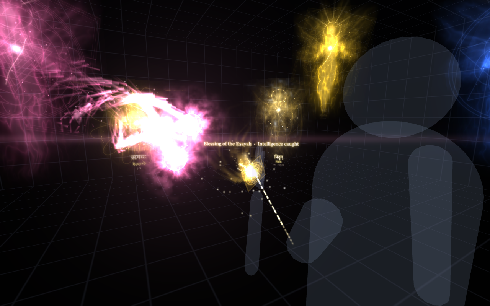
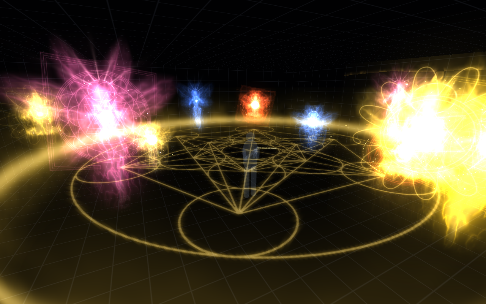
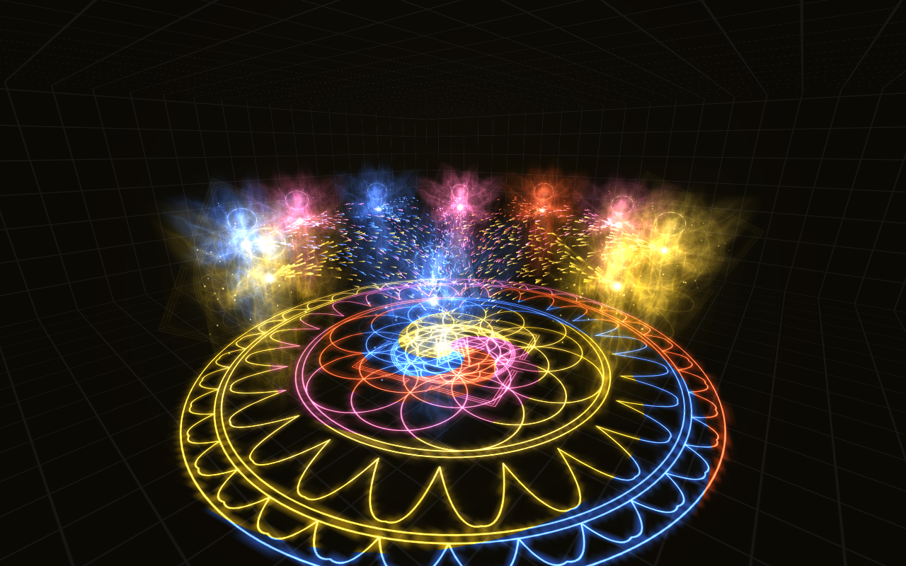
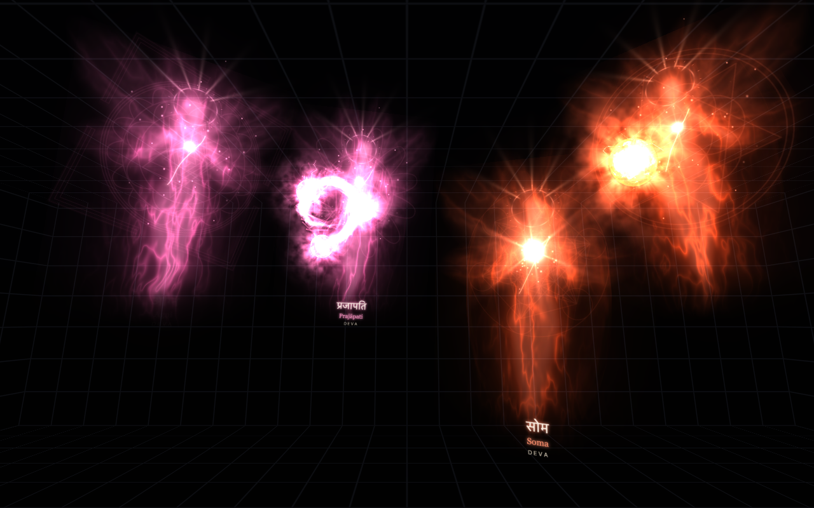
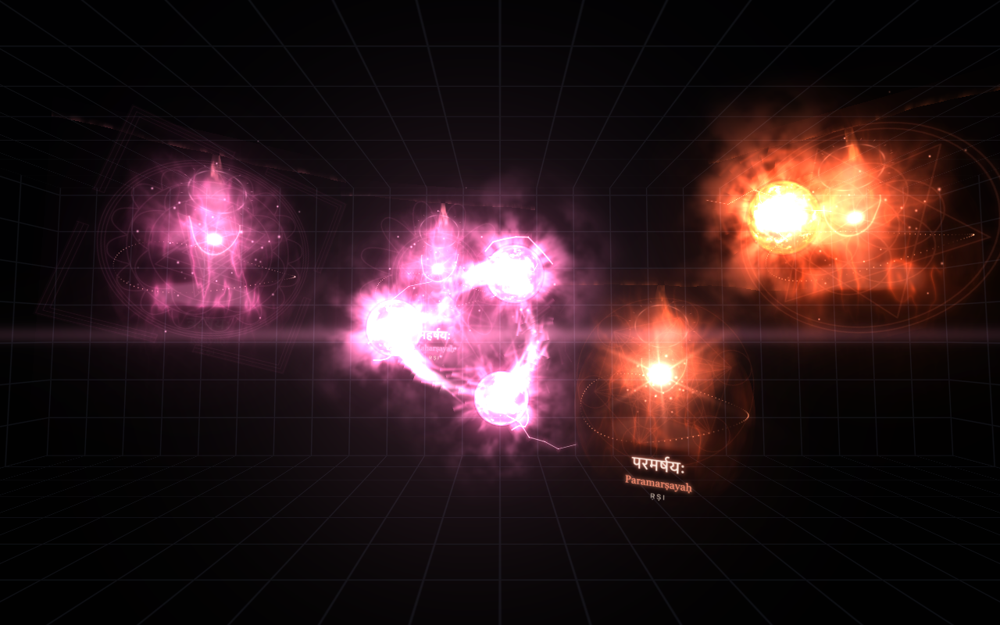
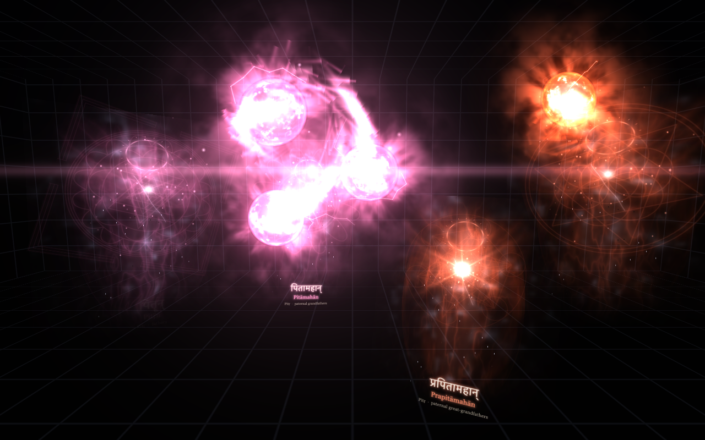
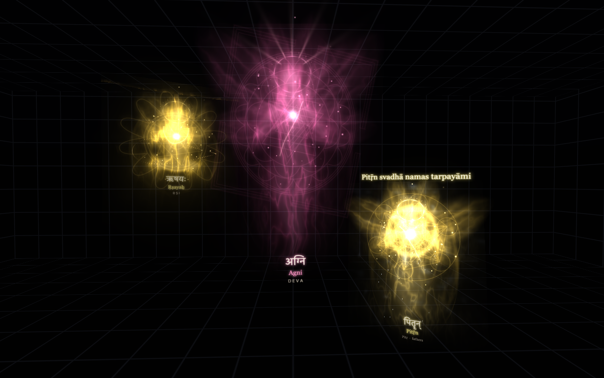

# Blessings of Light AR

A peaceful mixed-reality (passthrough) game for **Meta Quest 3**. Beings of light float all around you, a full 360 degrees, and keep sending you blessings as living balls of plasma. You bless them back with your hands. There is no damage, no health and no losing: only giving and receiving.

Hands only, no controllers. The qualities and their colours come from Puja VR, and the look and stack follow Energy Flow AR.

**Open it:** https://utubevsr-sketch.github.io/blessings-of-light-ar/


## How to play on Quest 3

1. Put on the headset and open the **Meta Quest Browser**.
2. Go to the address above and tap **Enter AR**. Allow hand tracking when asked. Space Setup is **not** needed.
3. Put the controllers down. Hand tracking turns on by itself.
4. The beings fade in around you. Turn around: they are behind and above you too.

### Receiving

Every few seconds one being gathers light into its core (it brightens and you hear a rising tone), then sends a ball of plasma toward your heart. It travels on a gentle curve, slowly enough to watch it come. When it arrives it passes into your body: a soft flare of your aura in that colour, a little crackle of lightning, a chime, and the quality's name floats in front of you ("Joy received").

**Catch it:** hold an **open palm** toward a blessing that is coming. It bends into your palm, orbs of light run up your forearm, your hand glows, and you get more Prana ("Joy caught").



### Giving

Your blessings are in the quality you choose in the menu. "All of this set" gives in all the set's colours.

- **Point and pinch:** point your hand at a being (a ring shows which one; it helps your aim) and pinch thumb and index finger. A ball of plasma flies to it.
- **Palm push:** hold an open palm toward the beings and push it forward quickly. A wide wave of blessing goes out and touches every being in that direction.
- **Anjali (Namaste):** press both palms together in front of your chest and hold them still for about a second. A ring of light gathers at your hands, then a ring of blessing goes out in every direction and touches every being at once. With full Prana it is a strong blessing and uses up the Prana; without it you send a gentle, softer ring.

When a being is blessed it brightens a step, opens its veils of light, spins its halo faster and sings its own note. It often blesses you back soon after. After **three** blessings it **ascends**: a column of light, a starburst, and it rises and dissolves into light. A new being appears somewhere else a few seconds later.




### Meters

Two small glowing arcs sit on your **left wrist** (look at the inside of your wrist):

- **Prana** (inner arc, in your colour): fills when you receive a blessing, more when you catch one. It pulses when full. Anjali uses it.
- **Harmony** (outer arc, gold): rises when your giving and receiving are in balance and when you bless many different beings. It settles slowly when nothing happens.

At **100% Harmony** comes the **Harmony Bloom**: every being glides into a ring around you at eye level, a large Flower of Life with a Sri Yantra at its heart forms on the floor around you, and they all shower you with light for about 8 seconds, with a choir-like swell. Then everything returns, and Harmony starts again at 50%.



### The menu (on your left hand)

**Turn your left palm toward your face** and hold it for a moment: the menu appears just above your left hand. Turn the palm away and it fades. Press buttons with your right hand: point and pinch, or poke a button with your right index fingertip. A short hint reminds you of this when you first enter.

- **Set 1 to Set 5**, the qualities with their colours, and **All of this set**: the quality of your blessings.
- **Beings:** All three (the default), Devas, Rishis or Pitrus.
- **How many:** Few (6), Many (10, the default) or Multitude (16).
- **Pace:** Calm or Lively.
- **Beings' qualities:** Same set as mine, or All sets (new beings take this).
- **Sacred geometry:** On or Off.
- **Sound:** On or Off.
- **Pause / Resume:** the beings stop sending blessings while paused.
- The Prana and Harmony bars and the counters: blessings given, received, caught, beings ascended and Harmony Blooms.

Your choices are saved for next time.


## Devas, Rishis and Pitrus

The beings are not nameless. Each is one of the **Devas, Rishis (Ṛṣis) and Pitrus (Pitṛs)** of the tarpaṇam. The names come from the **Yajurveda Bodhāyana-sūtra tarpaṇam, "Amma Alive" form**, as given in "Treta Ugadi Puṇyakāla Tarpaṇam" on the Gurukulam channel (https://www.youtube.com/watch?v=dwKx50BQWr0):
- The **Devas** and **Rishis** follow its Brahma-yajña Deva and Ṛṣi tarpaṇam.
- The **Pitrus** are the **24 Pitṛ categories** of its main tarpaṇam. They are categories, not personal names, so no one's own ancestor is named.

The lists follow that source exactly and in its order. They replace the earlier Rigvedic (Āśvalāyana) lists.

A soft name floats under each being: the name in Devanagari, the IAST spelling below it, and a small tag (Deva or Ṛṣi; for a Pitṛ, the tag carries the meaning, such as "Pitṛ · paternal grandfathers"). Names fade with distance and when you look away, so the 360° view stays clear. Collectives (the Vasus, the Seven Seers) appear as one being. Feminine beings (the goddesses, the consorts, the grandmothers and the wives) take a slenderer, more flowing form.

Each being still carries one quality and its colour, and every layer of its blessing is in that colour. The group shows in the form, with only a subtle accent on the thread, crown, beads and shimmer.

- **Devas** (thread over the left shoulder, *yajñopavītī*): tall, upright and the brightest, in the upper band. A crown of rays, and a fine thread of light from the left shoulder to the right hip. Their blessings leave from the **fingertips** (deva-tīrtha) as straight, brilliant bolts.
- **Rishis** (thread worn like a garland, *nivītī*): seated in padmāsana at mid-height, one hand raised. A crown of matted hair (jaṭā) burning upward like a still flame, a slowly turning **japa mālā of 108 bead-motes** and a calm amber-white core. Their blessings leave from the side of the raised palm in a slow **spiral of wisdom-light**.
- **Pitrus** (thread over the right shoulder, *prācīnāvītī*): lower, near the horizon, softer and more translucent, with a moonlit silvery shimmer and sesame-like dark specks and drops of water falling around them. Their blessings **pour in a gentle descending arc**, like water offered between thumb and forefinger (pitṛ-tīrtha), with soft ripples where they land.

By default all three groups appear together, about 40% Devas, 35% Rishis and 25% Pitrus. The menu row **Beings: All three / Devas / Rishis / Pitrus** chooses (and is remembered). When a being ascends, the **next name in that group's tarpaṇam order** takes its place, so a session cycles through the lists. Names that occur more than once in the tarpaṇam (Agni, Prajāpati, Soma, Rudra, Vāyu, Varuṇa, Yama, Brahmā, Viṣṇu, Indra) keep each occurrence in its place in the order, but never appear twice on screen at once.

On screen:
- A blessing that reaches you says who sent it, for example "Vasiṣṭha's blessing · Wisdom received", "Blessing of the Ṛṣayaḥ · …" for a collective, or "Blessing of your paternal grandfathers · …" for a Pitṛ.
- When you bless a being, its line appears near it for about 2 s:
  - Devas and Rishis: "Agniṃ tarpayāmi", "Vasiṣṭhaṃ tarpayāmi". A final -n takes its sandhi: "Vasūṃs tarpayāmi".
  - Pitrus: "Pitāmahān svadhā namas tarpayāmi".
- An Anjali to all shows "Sarvān devān ṛṣīn pitṝn tarpayāmi".






### The names, in tarpaṇam order

The source gives most names in plain spelling; here they have proper IAST and Devanagari, with the accusative as offered.

Choices made where the source leaves room:
- The eight forms of Śiva are offered as "Bhavaṃ devaṃ" and so on.
- Their consorts and sons are offered as separate beings ("Bhavasya devasya patnīṃ / sutaṃ tarpayāmi").
- "Ratha" in the transcript is read as **Varada**.
- "Kanva Bodhayana" is written **Kāṇva Bodhāyana**.

**Devas** (151): the eastern, southern, western and northern doors with the Vasus, Rudras, Ādityas and Sādhyas; Brahmā and his circle; the elements, lights and worlds; Śiva's eight forms with their consorts, sons and attendants; Skanda; Gaṇapati; the twelve names of Viṣṇu, Śrī, Hrī and Puṣṭi, and Vainateya; Yama and Dharma; Viṣṇu's attendants, the sages, Vidyā, Durgā and Jyeṣṭhā; Dhanvantari.

| # | Name | IAST | Meaning | Offered as |
| --- | --- | --- | --- | --- |
| 1 | अग्नि | Agni | Agni, fire | Agniṃ tarpayāmi |
| 2 | प्रजापति | Prajāpati | lord of all beings | Prajāpatiṃ tarpayāmi |
| 3 | सोम | Soma | Soma, the moon | Somaṃ tarpayāmi |
| 4 | रुद्र | Rudra | Rudra | Rudraṃ tarpayāmi |
| 5 | अदिति | Aditi | Aditi, mother of the gods | Aditiṃ tarpayāmi |
| 6 | बृहस्पति | Bṛhaspati | teacher of the gods | Bṛhaspatiṃ tarpayāmi |
| 7 | सर्पाः | Sarpāḥ | the Serpents | Sarpāṃs tarpayāmi |
| 8 | वसवः | Vasavaḥ | the Vasus, with the deities of the eastern door | Vasūṃs tarpayāmi |
| 9 | पितरः | Pitaraḥ | the Fathers, deities of the southern door | Pitṝṃs tarpayāmi |
| 10 | अर्यमा | Aryamā | Aryaman | Aryamaṇaṃ tarpayāmi |
| 11 | भग | Bhaga | Bhaga, giver of fortune | Bhagaṃ tarpayāmi |
| 12 | सविता | Savitā | Savitṛ, the impelling Sun | Savitāraṃ tarpayāmi |
| 13 | त्वष्टा | Tvaṣṭā | Tvaṣṭṛ, the divine shaper | Tvaṣṭāraṃ tarpayāmi |
| 14 | वायु | Vāyu | Vāyu, the wind | Vāyuṃ tarpayāmi |
| 15 | इन्द्राग्नी | Indrāgnī | Indra and Agni | Indrāgnī tarpayāmi |
| 16 | रुद्राः | Rudrāḥ | the Rudras, with the deities of the southern door | Rudrāṃs tarpayāmi |
| 17 | मित्र | Mitra | Mitra, friend of all | Mitraṃ tarpayāmi |
| 18 | इन्द्र | Indra | Indra, king of the gods | Indraṃ tarpayāmi |
| 19 | महापितरः | Mahāpitaraḥ | the Great Fathers | Mahāpitṝṃs tarpayāmi |
| 20 | आपः | Āpaḥ | the Waters | Apaḥ tarpayāmi |
| 21 | विश्वेदेवाः | Viśvedevāḥ | the All-gods | Viśvān devāṃs tarpayāmi |
| 22 | ब्रह्मा | Brahmā | Brahmā, the Creator | Brahmāṇaṃ tarpayāmi |
| 23 | विष्णु | Viṣṇu | Viṣṇu | Viṣṇuṃ tarpayāmi |
| 24 | आदित्याः | Ādityāḥ | the Ādityas, with the deities of the western door | Ādityāṃs tarpayāmi |
| 25 | वसवः | Vasavaḥ | the Vasus, deities of the northern door | Vasūṃs tarpayāmi |
| 26 | वरुण | Varuṇa | Varuṇa, lord of the waters | Varuṇaṃ tarpayāmi |
| 27 | अज एकपाद् | Aja Ekapād | the One-footed Unborn | Ajam Ekapādaṃ tarpayāmi |
| 28 | अहिर्बुध्न्य | Ahirbudhnya | the Serpent of the Deep | Ahirbudhnyaṃ tarpayāmi |
| 29 | पूषा | Pūṣā | Pūṣan, the nourisher | Pūṣaṇaṃ tarpayāmi |
| 30 | अश्विनौ | Aśvinau | the twin Aśvins, divine healers | Aśvinau tarpayāmi |
| 31 | यम | Yama | Yama | Yamaṃ tarpayāmi |
| 32 | साध्याः | Sādhyāḥ | the Sādhyas, with the deities of the northern door | Sādhyāṃs tarpayāmi |
| 33 | ब्रह्मा | Brahmā | Brahmā, first of his circle | Brahmāṇaṃ tarpayāmi |
| 34 | प्रजापति | Prajāpati | Brahmā as lord of beings | Prajāpatiṃ tarpayāmi |
| 35 | परमेष्ठी | Parameṣṭhī | who stands in the highest | Parameṣṭhinaṃ tarpayāmi |
| 36 | हिरण्यगर्भ | Hiraṇyagarbha | the Golden Womb | Hiraṇyagarbhaṃ tarpayāmi |
| 37 | चतुर्मुख | Caturmukha | the four-faced | Caturmukhaṃ tarpayāmi |
| 38 | स्वयम्भू | Svayambhū | the Self-born | Svayambhuvaṃ tarpayāmi |
| 39 | ब्रह्मपार्षदाः | Brahmapārṣadāḥ | Brahmā's attendants | Brahmapārṣadāṃs tarpayāmi |
| 40 | ब्रह्मपार्षद्यः | Brahmapārṣadyaḥ | Brahmā's women attendants | Brahmapārṣadīḥ tarpayāmi |
| 41 | अग्नि | Agni | Agni, fire | Agniṃ tarpayāmi |
| 42 | वायु | Vāyu | Vāyu, the wind | Vāyuṃ tarpayāmi |
| 43 | वरुण | Varuṇa | Varuṇa, the waters | Varuṇaṃ tarpayāmi |
| 44 | सोम | Soma | Soma | Somaṃ tarpayāmi |
| 45 | सूर्य | Sūrya | Sūrya, the Sun | Sūryaṃ tarpayāmi |
| 46 | चन्द्रमाः | Candramāḥ | the Moon | Candramasaṃ tarpayāmi |
| 47 | नक्षत्राणि | Nakṣatrāṇi | the Lunar Mansions | Nakṣatrāṇi tarpayāmi |
| 48 | ज्योतींषि | Jyotīṃṣi | the Lights of heaven | Jyotīṃṣi tarpayāmi |
| 49 | सद्योजात | Sadyojāta | the Instantly Born, face of Śiva | Sadyojātaṃ tarpayāmi |
| 50 | ओं भूः पुरुष | Oṃ Bhūḥ Puruṣa | the Person of the earth | Oṃ Bhūḥ Puruṣaṃ tarpayāmi |
| 51 | ओं भुवः पुरुष | Oṃ Bhuvaḥ Puruṣa | the Person of the mid-space | Oṃ Bhuvaḥ Puruṣaṃ tarpayāmi |
| 52 | ओं सुवः पुरुष | Oṃ Suvaḥ Puruṣa | the Person of heaven | Oṃ Suvaḥ Puruṣaṃ tarpayāmi |
| 53 | ओं भूर्भुवस्सुवः पुरुष | Oṃ Bhūrbhuvassuvaḥ Puruṣa | the Person of all three worlds | Oṃ Bhūrbhuvassuvaḥ Puruṣaṃ tarpayāmi |
| 54 | ओं भूः | Oṃ Bhūḥ | the earth world | Oṃ Bhūḥ tarpayāmi |
| 55 | ओं भुवः | Oṃ Bhuvaḥ | the mid-world | Oṃ Bhuvaḥ tarpayāmi |
| 56 | ओं सुवः | Oṃ Suvaḥ | the heaven world | Oṃ Suvaḥ tarpayāmi |
| 57 | ओं महः | Oṃ Mahaḥ | the world of greatness | Oṃ Mahaḥ tarpayāmi |
| 58 | ओं जनः | Oṃ Janaḥ | the world of the born | Oṃ Janaḥ tarpayāmi |
| 59 | ओं तपः | Oṃ Tapaḥ | the world of austerity | Oṃ Tapaḥ tarpayāmi |
| 60 | ओं सत्यम् | Oṃ Satyam | the world of truth | Oṃ Satyaṃ tarpayāmi |
| 61 | भव देव | Bhava Deva | Śiva as Bhava | Bhavaṃ devaṃ tarpayāmi |
| 62 | शर्व देव | Śarva Deva | Śiva as Śarva | Śarvaṃ devaṃ tarpayāmi |
| 63 | ईशान देव | Īśāna Deva | Śiva as Īśāna | Īśānaṃ devaṃ tarpayāmi |
| 64 | पशुपति देव | Paśupati Deva | Śiva as Paśupati | Paśupatiṃ devaṃ tarpayāmi |
| 65 | रुद्र देव | Rudra Deva | Śiva as Rudra | Rudraṃ devaṃ tarpayāmi |
| 66 | उग्र देव | Ugra Deva | Śiva as Ugra | Ugraṃ devaṃ tarpayāmi |
| 67 | भीम देव | Bhīma Deva | Śiva as Bhīma | Bhīmaṃ devaṃ tarpayāmi |
| 68 | महान् देव | Mahān Deva | Śiva as Mahān | Mahāntaṃ devaṃ tarpayāmi |
| 69 | भवस्य देवस्य पत्नी | Bhavasya Devasya Patnī | consort of Bhava | Bhavasya devasya patnīṃ tarpayāmi |
| 70 | शर्वस्य देवस्य पत्नी | Śarvasya Devasya Patnī | consort of Śarva | Śarvasya devasya patnīṃ tarpayāmi |
| 71 | ईशानस्य देवस्य पत्नी | Īśānasya Devasya Patnī | consort of Īśāna | Īśānasya devasya patnīṃ tarpayāmi |
| 72 | पशुपतेः देवस्य पत्नी | Paśupateḥ Devasya Patnī | consort of Paśupati | Paśupateḥ devasya patnīṃ tarpayāmi |
| 73 | रुद्रस्य देवस्य पत्नी | Rudrasya Devasya Patnī | consort of Rudra | Rudrasya devasya patnīṃ tarpayāmi |
| 74 | उग्रस्य देवस्य पत्नी | Ugrasya Devasya Patnī | consort of Ugra | Ugrasya devasya patnīṃ tarpayāmi |
| 75 | भीमस्य देवस्य पत्नी | Bhīmasya Devasya Patnī | consort of Bhīma | Bhīmasya devasya patnīṃ tarpayāmi |
| 76 | महतः देवस्य पत्नी | Mahataḥ Devasya Patnī | consort of Mahān | Mahataḥ devasya patnīṃ tarpayāmi |
| 77 | भवस्य देवस्य सुत | Bhavasya Devasya Suta | son of Bhava | Bhavasya devasya sutaṃ tarpayāmi |
| 78 | शर्वस्य देवस्य सुत | Śarvasya Devasya Suta | son of Śarva | Śarvasya devasya sutaṃ tarpayāmi |
| 79 | ईशानस्य देवस्य सुत | Īśānasya Devasya Suta | son of Īśāna | Īśānasya devasya sutaṃ tarpayāmi |
| 80 | पशुपतेः देवस्य सुत | Paśupateḥ Devasya Suta | son of Paśupati | Paśupateḥ devasya sutaṃ tarpayāmi |
| 81 | रुद्रस्य देवस्य सुत | Rudrasya Devasya Suta | son of Rudra | Rudrasya devasya sutaṃ tarpayāmi |
| 82 | उग्रस्य देवस्य सुत | Ugrasya Devasya Suta | son of Ugra | Ugrasya devasya sutaṃ tarpayāmi |
| 83 | भीमस्य देवस्य सुत | Bhīmasya Devasya Suta | son of Bhīma | Bhīmasya devasya sutaṃ tarpayāmi |
| 84 | महतः देवस्य सुत | Mahataḥ Devasya Suta | son of Mahān | Mahataḥ devasya sutaṃ tarpayāmi |
| 85 | रुद्राः | Rudrāḥ | the Rudras | Rudrāṃs tarpayāmi |
| 86 | रुद्रपार्षदाः | Rudrapārṣadāḥ | Rudra's attendants | Rudrapārṣadāṃs tarpayāmi |
| 87 | रुद्रपार्षद्यः | Rudrapārṣadyaḥ | Rudra's women attendants | Rudrapārṣadīḥ tarpayāmi |
| 88 | सनत्कुमार | Sanatkumāra | the eternal youth | Sanatkumāraṃ tarpayāmi |
| 89 | स्कन्द | Skanda | Skanda | Skandaṃ tarpayāmi |
| 90 | इन्द्र | Indra | Indra | Indraṃ tarpayāmi |
| 91 | षष्ठी | Ṣaṣṭhī | Ṣaṣṭhī, consort of Skanda | Ṣaṣṭhīṃ tarpayāmi |
| 92 | षण्मुख | Ṣaṇmukha | the six-faced | Ṣaṇmukhaṃ tarpayāmi |
| 93 | विशाख | Viśākha | Viśākha | Viśākhaṃ tarpayāmi |
| 94 | जयन्त | Jayanta | the victorious | Jayantaṃ tarpayāmi |
| 95 | महासेन | Mahāsena | commander of the gods | Mahāsenaṃ tarpayāmi |
| 96 | स्कन्दपार्षदाः | Skandapārṣadāḥ | Skanda's attendants | Skandapārṣadāṃs tarpayāmi |
| 97 | स्कन्दपार्षद्यः | Skandapārṣadyaḥ | Skanda's women attendants | Skandapārṣadīḥ tarpayāmi |
| 98 | विघ्न | Vighna | lord of obstacles | Vighnaṃ tarpayāmi |
| 99 | विनायक | Vināyaka | the remover | Vināyakaṃ tarpayāmi |
| 100 | वीर | Vīra | the hero | Vīraṃ tarpayāmi |
| 101 | शूर | Śūra | the valiant | Śūraṃ tarpayāmi |
| 102 | वरद | Varada | giver of boons | Varadaṃ tarpayāmi |
| 103 | हस्तिमुख | Hastimukha | the elephant-faced | Hastimukhaṃ tarpayāmi |
| 104 | एकदन्त | Ekadanta | the one-tusked | Ekadantaṃ tarpayāmi |
| 105 | लम्बोदर | Lambodara | the big-bellied | Lambodaraṃ tarpayāmi |
| 106 | वक्रतुण्ड | Vakratuṇḍa | of the curved trunk | Vakratuṇḍaṃ tarpayāmi |
| 107 | गणपति | Gaṇapati | lord of the hosts | Gaṇapatiṃ tarpayāmi |
| 108 | विघ्नपार्षदाः | Vighnapārṣadāḥ | Gaṇapati's attendants | Vighnapārṣadāṃs tarpayāmi |
| 109 | विघ्नपार्षद्यः | Vighnapārṣadyaḥ | Gaṇapati's women attendants | Vighnapārṣadīḥ tarpayāmi |
| 110 | केशव | Keśava | name of Viṣṇu | Keśavaṃ tarpayāmi |
| 111 | नारायण | Nārāyaṇa | name of Viṣṇu | Nārāyaṇaṃ tarpayāmi |
| 112 | माधव | Mādhava | name of Viṣṇu | Mādhavaṃ tarpayāmi |
| 113 | गोविन्द | Govinda | name of Viṣṇu | Govindaṃ tarpayāmi |
| 114 | विष्णु | Viṣṇu | name of Viṣṇu | Viṣṇuṃ tarpayāmi |
| 115 | मधुसूदन | Madhusūdana | name of Viṣṇu | Madhusūdanaṃ tarpayāmi |
| 116 | त्रिविक्रम | Trivikrama | name of Viṣṇu | Trivikramaṃ tarpayāmi |
| 117 | वामन | Vāmana | name of Viṣṇu | Vāmanaṃ tarpayāmi |
| 118 | श्रीधर | Śrīdhara | name of Viṣṇu | Śrīdharaṃ tarpayāmi |
| 119 | हृषीकेश | Hṛṣīkeśa | name of Viṣṇu | Hṛṣīkeśaṃ tarpayāmi |
| 120 | पद्मनाभ | Padmanābha | name of Viṣṇu | Padmanābhaṃ tarpayāmi |
| 121 | दामोदर | Dāmodara | name of Viṣṇu | Dāmodaraṃ tarpayāmi |
| 122 | श्रीदेवी | Śrīdevī | Śrī, goddess of fortune | Śrīdevīṃ tarpayāmi |
| 123 | ह्रीदेवी | Hrīdevī | Hrī, goddess of modesty | Hrīdevīṃ tarpayāmi |
| 124 | पुष्टिदेवी | Puṣṭidevī | Puṣṭi, goddess of nourishment | Puṣṭidevīṃ tarpayāmi |
| 125 | वैनतेय | Vainateya | Garuḍa | Vainateyaṃ tarpayāmi |
| 126 | काल | Kāla | Time | Kālaṃ tarpayāmi |
| 127 | नील | Nīla | the dark one | Nīlaṃ tarpayāmi |
| 128 | मृत्यु | Mṛtyu | Death | Mṛtyuṃ tarpayāmi |
| 129 | अन्तक | Antaka | the Ender | Antakaṃ tarpayāmi |
| 130 | यम | Yama | Yama | Yamaṃ tarpayāmi |
| 131 | यमराज | Yamarāja | King Yama | Yamarājaṃ tarpayāmi |
| 132 | धर्म | Dharma | Dharma | Dharmaṃ tarpayāmi |
| 133 | धर्मराज | Dharmarāja | king of dharma | Dharmarājaṃ tarpayāmi |
| 134 | चित्र | Citra | the bright one | Citraṃ tarpayāmi |
| 135 | चित्रगुप्त | Citragupta | keeper of the record of deeds | Citraguptaṃ tarpayāmi |
| 136 | वैवस्वत | Vaivasvata | son of the Sun | Vaivasvataṃ tarpayāmi |
| 137 | वैवस्वतपार्षदाः | Vaivasvatapārṣadāḥ | Yama's attendants | Vaivasvatapārṣadāṃs tarpayāmi |
| 138 | वैवस्वतपार्षद्यः | Vaivasvatapārṣadyaḥ | Yama's women attendants | Vaivasvatapārṣadīḥ tarpayāmi |
| 139 | विष्णु | Viṣṇu | Viṣṇu | Viṣṇuṃ tarpayāmi |
| 140 | विष्णुपार्षदाः | Viṣṇupārṣadāḥ | Viṣṇu's attendants | Viṣṇupārṣadāṃs tarpayāmi |
| 141 | विष्णुपार्षद्यः | Viṣṇupārṣadyaḥ | Viṣṇu's women attendants | Viṣṇupārṣadīḥ tarpayāmi |
| 142 | भरद्वाज | Bharadvāja | the seer Bharadvāja | Bharadvājaṃ tarpayāmi |
| 143 | गौतम | Gautama | the seer Gautama | Gautamaṃ tarpayāmi |
| 144 | अत्रि | Atri | the seer Atri | Atriṃ tarpayāmi |
| 145 | अङ्गिरस् | Aṅgiras | the seer Aṅgiras | Aṅgirasaṃ tarpayāmi |
| 146 | विद्या | Vidyā | Knowledge | Vidyāṃ tarpayāmi |
| 147 | दुर्गा | Durgā | Durgā | Durgāṃ tarpayāmi |
| 148 | ज्येष्ठा | Jyeṣṭhā | Jyeṣṭhā, the elder goddess | Jyeṣṭhāṃ tarpayāmi |
| 149 | धन्वन्तरि | Dhanvantari | physician of the gods | Dhanvantariṃ tarpayāmi |
| 150 | धन्वन्तरिपार्षदाः | Dhanvantaripārṣadāḥ | Dhanvantari's attendants | Dhanvantaripārṣadāṃs tarpayāmi |
| 151 | धन्वन्तरिपार्षद्यः | Dhanvantaripārṣadyaḥ | Dhanvantari's women attendants | Dhanvantaripārṣadīḥ tarpayāmi |

**Rishis** (39): the classes and families of seers; the seers and authors of Sūtras; the Vedas, metres and all beings.

| # | Name | IAST | Meaning | Offered as |
| --- | --- | --- | --- | --- |
| 1 | ऋषयः | Ṛṣayaḥ | the Seers | Ṛṣaīṃs tarpayāmi |
| 2 | महर्षयः | Maharṣayaḥ | the great Seers | Maharṣaīṃs tarpayāmi |
| 3 | परमर्षयः | Paramarṣayaḥ | the supreme Seers | Paramarṣaīṃs tarpayāmi |
| 4 | देवर्षयः | Devarṣayaḥ | the divine Seers | Devarṣaīṃs tarpayāmi |
| 5 | ब्रह्मर्षयः | Brahmarṣayaḥ | the Brahmin Seers | Brahmarṣaīṃs tarpayāmi |
| 6 | राजर्षयः | Rājarṣayaḥ | the royal Seers | Rājarṣaīṃs tarpayāmi |
| 7 | वैश्यर्षयः | Vaiśyarṣayaḥ | the merchant Seers | Vaiśyarṣaīṃs tarpayāmi |
| 8 | सूतर्षयः | Sūtarṣayaḥ | the bard Seers | Sūtarṣaīṃs tarpayāmi |
| 9 | श्रुतर्षयः | Śrutarṣayaḥ | the Seers of hearing | Śrutarṣaīṃs tarpayāmi |
| 10 | जनर्षयः | Janarṣayaḥ | the Seers of the people | Janarṣaīṃs tarpayāmi |
| 11 | तपर्षयः | Taparṣayaḥ | the Seers of austerity | Taparṣaīṃs tarpayāmi |
| 12 | सत्यर्षयः | Satyarṣayaḥ | the Seers of truth | Satyarṣaīṃs tarpayāmi |
| 13 | सप्तर्षयः | Saptarṣayaḥ | the Seven Seers | Saptarṣaīṃs tarpayāmi |
| 14 | काण्डर्षयः | Kāṇḍarṣayaḥ | the Seers of the Veda sections | Kāṇḍarṣaīṃs tarpayāmi |
| 15 | ऋषिकाः | Ṛṣikāḥ | the lesser Seers | Ṛṣikāṃs tarpayāmi |
| 16 | ऋषिपत्न्यः | Ṛṣipatnyaḥ | the Seers' wives | Ṛṣipatnīḥ tarpayāmi |
| 17 | ऋषिपुत्राः | Ṛṣiputrāḥ | the Seers' sons | Ṛṣiputrāṃs tarpayāmi |
| 18 | ऋषिपौत्राः | Ṛṣipautrāḥ | the Seers' grandsons | Ṛṣipautrāṃs tarpayāmi |
| 19 | काण्व बोधायन | Kāṇva Bodhāyana | author of our Sūtra | Kāṇvaṃ Bodhāyanaṃ tarpayāmi |
| 20 | आपस्तम्ब सूत्रकार | Āpastamba Sūtrakāra | Āpastamba, author of a Sūtra | Āpastambaṃ Sūtrakāraṃ tarpayāmi |
| 21 | सत्याषाढ हिरण्यकेशिन् | Satyāṣāḍha Hiraṇyakeśin | Satyāṣāḍha, author of a Sūtra | Satyāṣāḍhaṃ Hiraṇyakeśinaṃ tarpayāmi |
| 22 | वाजसनेय याज्ञवल्क्य | Vājasaneya Yājñavalkya | seer of the White Yajurveda | Vājasaneyaṃ Yājñavalkyaṃ tarpayāmi |
| 23 | आश्वलायन शौनक | Āśvalāyana Śaunaka | teachers of the Ṛgveda Sūtra | Āśvalāyanaṃ Śaunakaṃ tarpayāmi |
| 24 | व्यास | Vyāsa | arranger of the Vedas | Vyāsaṃ tarpayāmi |
| 25 | वसिष्ठ | Vasiṣṭha | the seer Vasiṣṭha | Vasiṣṭhaṃ tarpayāmi |
| 26 | प्रणव | Praṇava | the syllable Om | Praṇavaṃ tarpayāmi |
| 27 | व्याहृतयः | Vyāhṛtayaḥ | the Vyāhṛtis: bhūḥ, bhuvaḥ, suvaḥ | Vyāhṛtīḥ tarpayāmi |
| 28 | सावित्री | Sāvitrī | the verse to Savitṛ | Sāvitrīṃ tarpayāmi |
| 29 | गायत्री | Gāyatrī | Gāyatrī, mother of the Vedas | Gāyatrīṃ tarpayāmi |
| 30 | छन्दांसि | Chandāṃsi | the Metres | Chandāṃsi tarpayāmi |
| 31 | सदसस्पति | Sadasaspati | lord of the assembly | Sadasaspatiṃ tarpayāmi |
| 32 | ऋग्वेद | Ṛgveda | the Ṛgveda | Ṛgvedaṃ tarpayāmi |
| 33 | यजुर्वेद | Yajurveda | the Yajurveda | Yajurvedaṃ tarpayāmi |
| 34 | सामवेद | Sāmaveda | the Sāmaveda | Sāmavedaṃ tarpayāmi |
| 35 | अथर्ववेद | Atharvaveda | the Atharvaveda | Atharvavedaṃ tarpayāmi |
| 36 | अथर्वाङ्गिरसः | Atharvāṅgirasaḥ | the Atharvan and Aṅgiras hymns | Atharvāṅgirasaḥ tarpayāmi |
| 37 | इतिहासपुराणानि | Itihāsapurāṇāni | the Epics and Purāṇas | Itihāsapurāṇāni tarpayāmi |
| 38 | सर्पदेवजनाः | Sarpadevajanāḥ | the serpent and divine peoples | Sarpadevajanāṃs tarpayāmi |
| 39 | सर्वभूतानि | Sarvabhūtāni | all beings | Sarvabhūtāni tarpayāmi |

**Pitrus** (the 24 categories of the main tarpaṇam): the paternal line, the maternal line, then teachers, kinsmen and all souls.

| # | Name | IAST | Meaning | Offered as |
| --- | --- | --- | --- | --- |
| 1 | पितॄन् | Pitṝn | fathers | Pitṝn svadhā namas tarpayāmi |
| 2 | पितामहान् | Pitāmahān | paternal grandfathers | Pitāmahān svadhā namas tarpayāmi |
| 3 | प्रपितामहान् | Prapitāmahān | paternal great-grandfathers | Prapitāmahān svadhā namas tarpayāmi |
| 4 | पितामहीः | Pitāmahīḥ | paternal grandmothers | Pitāmahīḥ svadhā namas tarpayāmi |
| 5 | पितुः पितामहीः | Pituḥ Pitāmahīḥ | paternal great-grandmothers | Pituḥ Pitāmahīḥ svadhā namas tarpayāmi |
| 6 | पितुः प्रपितामहीः | Pituḥ Prapitāmahīḥ | paternal great-great-grandmothers | Pituḥ Prapitāmahīḥ svadhā namas tarpayāmi |
| 7 | मातामहान् | Mātāmahān | maternal grandfathers | Mātāmahān svadhā namas tarpayāmi |
| 8 | मातुः पितामहान् | Mātuḥ Pitāmahān | maternal great-grandfathers | Mātuḥ Pitāmahān svadhā namas tarpayāmi |
| 9 | मातुः प्रपितामहान् | Mātuḥ Prapitāmahān | maternal great-great-grandfathers | Mātuḥ Prapitāmahān svadhā namas tarpayāmi |
| 10 | मातामहीः | Mātāmahīḥ | maternal grandmothers | Mātāmahīḥ svadhā namas tarpayāmi |
| 11 | मातुः पितामहीः | Mātuḥ Pitāmahīḥ | maternal great-grandmothers | Mātuḥ Pitāmahīḥ svadhā namas tarpayāmi |
| 12 | मातुः प्रपितामहीः | Mātuḥ Prapitāmahīḥ | maternal great-great-grandmothers | Mātuḥ Prapitāmahīḥ svadhā namas tarpayāmi |
| 13 | आचार्यान् | Ācāryān | teachers | Ācāryān svadhā namas tarpayāmi |
| 14 | आचार्यपत्नीः | Ācāryapatnīḥ | teachers' wives | Ācāryapatnīḥ svadhā namas tarpayāmi |
| 15 | गुरून् | Gurūn | gurus | Gurūn svadhā namas tarpayāmi |
| 16 | गुरुपत्नीः | Gurupatnīḥ | gurus' wives | Gurupatnīḥ svadhā namas tarpayāmi |
| 17 | सखीन् | Sakhīn | friends | Sakhīn svadhā namas tarpayāmi |
| 18 | सखिपत्नीः | Sakhipatnīḥ | friends' wives | Sakhipatnīḥ svadhā namas tarpayāmi |
| 19 | ज्ञातीन् | Jñātīn | kinsmen | Jñātīn svadhā namas tarpayāmi |
| 20 | ज्ञातिपत्नीः | Jñātipatnīḥ | kinsmen's wives | Jñātipatnīḥ svadhā namas tarpayāmi |
| 21 | अमात्यान् | Amātyān | associates and companions | Amātyān svadhā namas tarpayāmi |
| 22 | अमात्यपत्नीः | Amātyapatnīḥ | companions' wives | Amātyapatnīḥ svadhā namas tarpayāmi |
| 23 | सर्वान् | Sarvān | all departed men | Sarvān svadhā namas tarpayāmi |
| 24 | सर्वाः | Sarvāḥ | all departed women | Sarvāḥ svadhā namas tarpayāmi |

**Devanagari on the Quest:** names are drawn with the font stack Noto Sans Devanagari, Kohinoor/Devanagari MT and others. Android, on which the Quest Browser runs, normally ships Noto Sans Devanagari. If no Devanagari font is found, the app notices and shows the IAST name larger instead, so a name never turns into empty boxes.

## What you see

- **Beings of light:** a white-hot core inside a soft, roughly human radiance of flowing light, arms open in blessing, a robe of light that thins into flame, a slowly turning halo ring, six breathing veils of light like wings or petals, orbiting motes, layered shells of light and a faint yantra behind (Sri Yantra, Anahata, Metatron's Cube or the Seed of Life). Each being carries one quality and its colour. They float 2.5 to 4.6 m away, from knee height to well above your head, slowly circling and bobbing, always facing you.
- **Plasma blessings:** a dense, churning ball of plasma with a white-hot core and a turbulent corona, lightning filaments wrapped round it, a motion-blur trail and shed sparks. Each quality has its own kind: a single orb, three small orbs spiralling round each other, a slow large sphere, or a quick comet with a long tail.
- **One colour for everything:** every layer of a blessing (corona, trail, lightning, sparks, aura, hand glow, flare, sacred geometry) is tinted in its quality's colour. Only cores go white-hot. Dark colours are lifted and pale ones strengthened so they read over your room, as in Energy Flow.
- Glows are capped near your eyes and the flare never covers more than about a third, so your room always stays visible.


## Sound

A soft drone, a rising tone as a being gathers light, a whoosh as a blessing sets off (you hear where it comes from), a chime when one reaches you, a note for each being you bless (a pentatonic scale, a different note per being), bells for Anjali and ascension, and a choir-like swell for the Harmony Bloom. Sound starts when you tap Enter AR.

## Desktop preview

Open the page in a normal browser. You get a dim stand-in room. Drag to look around, click a being to bless it, and use the keys:

| Key | Does |
| --- | --- |
| P | Palm push toward the middle of the view |
| N | Anjali (both palms together for about a second) |
| C | Hold out an open palm to catch (press again to lower it) |
| M | Show or hide the menu |

The meters show at the lower right. For screenshots and checks:

| URL | Shows |
| --- | --- |
| `?demo` | First person: beings with blessings frozen mid-flight, one being gathering light |
| `?demo=360` | Third person: the beings all around a stand-in person |
| `?demo=being` | Close-up of a being (`&lvl=0..2` how blessed it is, `&wind` gathering light) |
| `?demo=catch` | A stand-in hand catching blessings, orbs running up the forearm |
| `?demo=give` | Your blessings hitting beings, and a palm-push wave |
| `?demo=anjali` | Anjali seen from outside (`&stop=1.0` shows the ring gathering at the hands) |
| `?demo=bloom` | The Harmony Bloom from a third-person view |
| `?demo=menu` | A stand-in left palm turned toward you, showing the menu |
| `?demo=devas`, `?demo=rishis`, `?demo=pitrus` | One group at a time, each sending a blessing in its own way |
| `?demo=labels` | The floating names, and the tarpaṇam line of a being you have just blessed |
| `?demo=smoke&xrhands` | Smoke test: fake WebXR hand joints and a WebXR 'select' (pinch) go through the same code the headset uses, for pinch, palm push, catch and Anjali. Sets `window.__smoke` |
| `&set=0..4&q=0..4` (`q=-1` all of the set), `&bq=all`, `&n=0..2`, `&only=0..3` (all three, Devas, Rishis, Pitrus), `&seed=`, `&stop=`, `&sacred=0`, `&noroom` | Your quality, beings' qualities, number of beings, random seed, freeze time, sacred geometry off, no stand-in room |

`tools/check.py` runs every view in headless Chrome, fails on any console error, saves the screenshots in `screenshots/` and runs the smoke test:

```
python3 -m http.server 8765
python3 tools/check.py
```

## Guesses to confirm

All of these are first guesses, easy to change:

- Beings float 2.5 to 4.6 m away, from 0.55 m to 2.85 m high, circling at 1 to 2.6 degrees a second.
- Pace: a being blesses you every 3 to 5 s (Calm) or 1.8 to 3 s (Lively); at most 5 blessings come at you at once and 12 are in flight in total.
- Wind-up 0.6 s. Speeds: orb 3.0 m/s, spiral 2.8 m/s, sphere 2.4 m/s, comet 3.5 m/s.
- The heart target is 23 cm below and 15 cm in front of your eyes (as in Energy Flow).
- Catching: an open palm (fingertips on average more than 6.5 cm from the palm centre) facing the blessing within 60 degrees, while it is between 12% and 90% of its way.
- Aim assist: 8 degrees round your pointing ray.
- Palm push: an open palm moving faster than 0.8 m/s along its normal for two frames; the wave spreads in a 30-degree cone at 4.4 m/s; one push every 0.9 s at most.
- Anjali: palm centres closer than 8 cm, palms facing each other, in front of your chest, held 1 s. It is charged when Prana is full.
- Prana: +12% per blessing received, +22% per blessing caught.
- Harmony starts at 35%. Each blessing you give adds about 1 to 5.4% (more when giving and receiving are balanced over the last 30 s and when many different beings were blessed in the last 40 s); each blessing received adds about 1.4 to 3.4%; a charged Anjali adds 12%. With nothing happening for 8 s it settles slowly back toward 35%.
- Harmony Bloom lasts 8 s, the beings form a ring 2.4 m around you, and Harmony restarts at 50%.
- A being ascends after 3 blessings and a new one appears 3 to 5 s later.
- The group mix (40% Devas, 35% Rishis, 25% Pitrus), the height bands of the groups (Devas 2.0 to 2.85 m, Rishis 1.3 to 2.05 m, Pitrus 0.85 to 1.45 m), and the blessing speeds by group: Devas 1.25 times as fast, Rishis 0.7 times, Pitrus 0.8 times.
- Names show clearly within about 4 m, fade out by 6.5 m, and show only within about 18 to 35 degrees of where you look.
- The menu opens when the left palm faces your eyes (within about 50 degrees) for 0.3 s and closes 0.5 s after you turn away (as in Energy Flow).
- Performance: with 16 beings there are about 100 draw calls plus effects; the flowing light of each being is drawn in one shader pass. Foveation is 0.5. To be checked on the headset; Few or Many is lighter.

## Glossary of divine names

Every name in the code that the app defines itself is a divine name, from the Vishnu and Lalita Sahasranamas, the 108 names of Shiva and other names of the Divine, chosen to fit the meaning where possible. That covers variables, functions, classes, shader names and the app's own object keys. Three.js, WebXR, the browser, WebAudio and GLSL names cannot change, so they stay as they are: in particular WebXR joint names such as `wrist` and `handedness`. The quality data, the text you see, the URL parameters, the saved-settings keys and the smoke-test results are also unchanged. The full list (952 names) is at the top of [`main.js`](main.js). The main parts are:

| Divine name | Was | What it does |
| --- | --- | --- |
| `GUNASAGARA` | `QUALITY_SETS` | the 5 sets of 24 qualities and colours, from Puja VR |
| `SARVAGUNA` | `ALL_QUALITIES` | all 24 qualities in one list |
| `sankalpa` | `state` | the menu choices, saved in localStorage (its keys are unchanged) |
| `smarana` | `save` | saves the menu choices |
| `shruti` | `params` | URL parameters |
| `gunanidhi` | `selectedQualities` | your chosen quality, or the whole set |
| `varna` | `palette` | the five-colour palette that tints every layer of a blessing |
| `tejovardhana` | `liftColor` | lifts dark colours and strengthens pale ones so their glow reads over a bright room |
| `vishvakarma` | `renderer` | the WebGL renderer (the divine architect) |
| `vishvarupa` | `scene` | the scene: the whole visible universe |
| `sahasraksha` | `camera` | the camera (Indra, the thousand-eyed) |
| `mahakala` | `clock` | app time in seconds |
| `kalachakra` | `frameClock` | the frame clock |
| `kalashakti` | `timeU` | the shared time uniform of every shader |
| `POORNAM` | `TAU` | 2 pi, the full circle |
| `HIRANYAGARBHA` | `PHI` | the golden ratio |
| `SURYANARAYANA` | `GOLDEN_ANGLE` | the golden angle, 137.5 degrees |
| `URDHVAGA` | `UP` | the up vector |
| `shanta` | `smooth` | smoothstep in JavaScript |
| `lila` | `rand` | a random number in a range |
| `PRAKASHA` | `GLOW_BLEND` | additive-light blending that keeps the passthrough visible |
| `MAYA` | `NOISE` | GLSL hash, value noise and fractal noise |
| `VARNAPATHA` | `PALETTE_GLSL` | GLSL palette uniform and colour pickers |
| `varnadhara` | `colorAt` | palette colour by key (GLSL) |
| `varnamala` | `colorSmooth` | blended palette colour (GLSL) |
| `mayapati` | `fbm2` | 2D fractal noise (GLSL) |
| `mayadhisha` | `fbm3` | 3D fractal noise for the roiling plasma (GLSL) |
| `mayini` | `noise2` | 2D value noise (GLSL) |
| `mahamayini` | `noise3` | 3D value noise (GLSL) |
| `chitragupta` | `hash12` | hash (GLSL) |
| `chitrasena` | `hash13` | 3D hash (GLSL) |
| `bhutatma` | `quadGeo` | the shared 2x2 quad |
| `mangalamparam` | `streakQuad` | the shared streak quad (tail to head) |
| `bahurupa` | `makeInstanced` | builds an instanced geometry from a base shape |
| `LEELADHARA` | `DEMO` | ?demo is on |
| `LEELARUPA` | `DEMO_MODE` | which ?demo view |
| `KARAKA` | `FAKE_XR` | fake XRHand joints are on (smoke test) |
| `BHUTAKRIT` | `STOP_AT` | demo time at which everything freezes, for screenshots |
| `BHUTABHRIT` | `THIRD_PERSON` | the demo looks at a stand-in person from outside |
| `satsanga` | `session` | session state (paused) |
| `punyalekha` | `stats` | the session counters: given, received, caught, ascended, blooms |
| `Deva` | `Being` | one being of light (class) |
| `devagana` | `beings` | all the beings |
| `DEVASANKHYA` | `BEING_COUNTS` | Few / Many / Multitude |
| `LAYA` | `PACES` | Calm / Lively: seconds between blessings |
| `GUNAVIDHI` | `BEING_QUALITY_MODES` | the beings' qualities: same set as yours, or all sets |
| `devarupa` | `presenceMat` | the radiant figure: core, flowing body, arms, robe of light and halo ring |
| `kosha` | `shellMat` | the layered fresnel shells (sheaths) round a being |
| `pakshaveda` | `veilGeo` | instanced geometry of the six veils |
| `garudapaksha` | `veilMat` | the breathing veils of light like wings or petals |
| `taraveda` | `moteGeo` | instanced geometry of the orbiting motes |
| `tarakagana` | `moteMat` | motes of light orbiting a being |
| `YANTRAMALA` | `BEING_YANTRAS` | the yantras drawn faintly behind the beings |
| `koshaveda` | `shellGeo` | the sphere behind each shell |
| `meru` | `beingCentre` | the centre the beings circle: you, followed slowly |
| `dikpala` | `pickAzimuth` | picks a direction away from the other beings |
| `devasabha` | `syncBeingCount` | adds or sends away beings to match the menu |
| `jagrata` | `liveBeings` | the beings that are present |
| `Prasada` | `Bolt` | one blessing in flight: a ball of plasma with its trail (class) |
| `prasadapatra` | `bolts` | the pool of 12 blessings |
| `VARADANA` | `BOLT_TYPES` | kinds of blessing: orb, spiral, sphere, comet |
| `DVADASHA` | `BOLT_CAP` | most blessings in flight at once (12) |
| `MARGA` | `BOLT_PATH` | GLSL path of a blessing: curve, tangent, spiral orbs |
| `gunavahana` | `typeForQuality` | which kind of blessing a quality sends |
| `tejoveda` | `plasmaGeo` | instanced quads of the plasma balls (three for a spiral) |
| `tejasbindu` | `plasmaMat` | the plasma ball: churning sphere, white-hot core, turbulent corona |
| `ketuveda` | `trailGeo` | instanced streaks of the trail |
| `dhumaketu` | `trailMat` | the motion-blur trail (a comet tail) |
| `mukta` | `freeBolt` | a free blessing from the pool |
| `agamana` | `incomingCount` | how many blessings are coming to you |
| `anugraha` | `fireIncoming` | a being sends you a blessing |
| `pratigrahana` | `receiveBlessing` | a blessing reaches your heart or your palm |
| `dana` | `giveBolt` | you send a blessing to a being (or along your ray) |
| `svasti` | `blessArrives` | your blessing reaches a being |
| `sahasrara` | `head` | your eyes, as rendered |
| `sahasraradisha` | `headQ` | head orientation |
| `jivatma` | `userHead` | the person the beings bless: you, or the stand-in |
| `purvadisha` | `fwd` | where you look |
| `purvottara` | `fwdYaw` | where you face, level |
| `hridaya` | `chest` | the heart target, 23 cm below and 15 cm in front of the eyes |
| `NARAYANA` | `PHANTOM` | the stand-in person's eyes in third-person demos |
| `vajra` | `lightning` | the lightning system |
| `agni` | `sparks` | sparks and embers |
| `prabhu` | `dotTex` | soft dot texture |
| `tejomaya` | `aura` | the aura shells round your body |
| `tejasvi` | `auraMat` | aura shell material |
| `tejasvini` | `auraU` | aura uniforms |
| `surya` | `flare` | head-locked flare and bloom overlay, capped so passthrough stays visible |
| `vani` | `labels` | floating words such as 'Joy received' |
| `vidyut` | `flashes` | flashes where your blessings strike a being |
| `tarangini` | `waves` | the palm-push waves |
| `TARANGA` | `WAVE_CONE` | half-angle of the palm-push wave (30 degrees) |
| `sangama` | `gather` | the ring of light gathering at joined palms |
| `sangamashakti` | `gatherU` | its uniforms |
| `sangamayantra` | `gatherYantra` | the Seed of Life at joined palms |
| `digvijaya` | `radialRing` | the Anjali's 360-degree ring of blessing |
| `digvijayashakti` | `ringU` | its uniforms |
| `digbrahma` | `ringMetatron` | Metatron's Cube spreading with a charged Anjali |
| `anjalimudra` | `anjali` | Anjali state: hold, cooldown, ring, count |
| `utkranti` | `ascensions` | ascension columns and starbursts |
| `vasanta` | `bloom` | the Harmony Bloom state |
| `vasantavarna` | `bloomColors` | its colours, from the beings |
| `bhumandala` | `floorMandala` | the Flower of Life / Sri Yantra mandala on the floor |
| `amritavarsha` | `shower` | the shower of light from every being in the Bloom |
| `amritadhara` | `showerU` | its uniforms |
| `hastajyoti` | `handGlow` | glow on fingertips and palms |
| `kripa` | `handMotes` | orbs drawn into the palm and up the forearm |
| `hrishikeshayantra` | `heartYantra` | Anahata at the heart when a blessing enters |
| `karayantra` | `palmYantras` | a Sri Yantra on a palm that catches a blessing |
| `kankana` | `wristMeters` | Prana and Harmony arcs on the left wrist |
| `kankanashakti` | `wristU` | their uniforms |
| `chhayahasta` | `standInHands` | translucent stand-in hands (desktop demos) |
| `chhayanyasa` | `poseStandIn` | poses a stand-in hand |
| `purusha` | `phantomBody` | translucent stand-in body for third-person demos |
| `vibhuti` | `effects` | the effects director: impacts, catches, waves, rings, lightning, flare |
| `shriyantradhara` | `sacredU` | sacred geometry on/off fade |
| `chitrakara` | `lineTex` | draws a line texture once |
| `lalita` | `sriYantraTex` | Sri Yantra line texture |
| `hrishikesha` | `anahataTex` | Anahata (heart) mandala texture |
| `brahma` | `metatronTex` | Metatron's Cube / Fruit of Life texture |
| `kartikeya` | `seedTex` | Seed of Life and hexagram texture |
| `shripura` | `bloomTex` | the Harmony Bloom floor mandala texture |
| `tripura` | `drawSriYantra` | draws the Sri Yantra |
| `pushpitavana` | `drawFlowerOfLife` | draws the Flower of Life |
| `SHRICHAKRA` | `SACRED_FRAG` | GLSL glow of the sacred line textures |
| `yantreshvari` | `sacredMat` | material for a sacred texture on a quad |
| `vastu` | `room` | the desktop stand-in room |
| `vastupurusha` | `roomMat` | room grid material |
| `samatvam` | `meters` | the Prana and Harmony meters |
| `saraswati` | `panel` | the menu panel |
| `jagadguru` | `menuHint` | the floating 'turn your left palm' hint |
| `chakrapani` | `pointers` | the two hand pointers (ray and reticle) |
| `mushika` | `mouse` | the desktop mouse pointer (Ganesha's mouse) |
| `lakshya` | `aim` | aims a pointer: the panel, or the being nearest the ray (aim assist) |
| `DRISHTIKONA` | `AIM_CONE` | aim-assist cone (8 degrees) |
| `ashirvada` | `onSelect` | handles a pinch |
| `bindu` | `makeReticle` | builds the ring that marks the being you point at |
| `tarjani` | `makePointer` | builds a pointer |
| `drishti` | `raycaster` | raycaster |
| `nadabrahma` | `audio` | all sound |
| `gopura` | `desk` | desktop stand-ins for gestures (keys P, N, C) |
| `gopurahasta` | `deskHands` | stand-in hands made from those keys |
| `gopurabindu` | `deskHandPoint` | where the desktop blessing leaves from |
| `gopurashirvada` | `onSelectDesk` | handles a desktop click |
| `panduranga` | `xrHands` | the two WebXR hands |
| `hastamalaka` | `readHands` | reads the hands: palm, normal, wrist, forearm, tips, velocity |
| `sandhihasta` | `jointHands` | hands from WebXR joints |
| `hastanirmana` | `makeHand` | a hand described directly (desktop and demos) |
| `varadahasta` | `menuDemoHand` | stand-in left palm for ?demo=menu |
| `abhaya` | `demoHands` | stand-in hands for the demos |
| `mudra` | `buildFakeJoints` | builds XRHand-like joints for the smoke test |
| `parikshamudra` | `smokePoses` | hand poses of the smoke test |
| `hastagati` | `handTrack` | palm velocity per hand |
| `VAYUVEGA` | `PUSH_SPEED` | palm-push speed along the palm normal (0.8 m/s) |
| `hastamudra` | `gestures` | palm push and Anjali detection |
| `mudralekha` | `gestureStats` | gesture counters |
| `ISHVARA` | `TIP_JOINTS` | WebXR fingertip joint names |
| `pushpavrishti` | `startBloom` | begins the Harmony Bloom |
| `pushpotsava` | `updateBloom` | runs the Harmony Bloom |
| `kalayojana` | `scheduleIncoming` | the beings take turns to bless you |
| `agamikala` | `nextFire` | when the next being blesses you |
| `kalarekha` | `timeline` | demo and smoke-test script |
| `muhurta` | `at` | schedules a step of that script |
| `darshana` | `lookFrom` | points the demo camera |
| `vyuha` | `arrange` | places beings for a demo |
| `leela` | `startDemo` | sets up ?demo views |
| `agnipariksha` | `smokeTest` | the hand-tracking smoke test |
| `sambhava` | `enterBtn` | the Enter AR button |
| `bhavana` | `hintEl` | the desktop hint |
| `bharta` | `needPlace` | place the menu on the first AR frame |
| `prabhava` | `noAR` | shows that AR is not available |
| `vikarta` | `uColors` | palette uniform (5 colours) |
| `vidarana` | `uTime` | time uniform |
| `ijya` | `uTex` | texture uniform |
| `satra` | `uAlpha` | brightness uniform of a sacred texture |
| `sarvajna` | `uRot` | rotation uniform |
| `sarvadarshi` | `uBillboard` | faces you when set |
| `vimuktatma` | `uScale` | size uniform |
| `mahejya` | `uSacred` | sacred geometry on/off (uniform) |
| `TARPANAVIDHI` | `TARPANA` | the Devas, Rishis and Pitrus of the tarpanam: Devanagari, IAST, gloss, tarpayāmi form |
| `TRIVARGA` | `LINEAGES` | the three groups: Deva, Rishi, Pitru |
| `GOTRANAMA` | `LINEAGE_TAG` | the small group tag under a name |
| `GOTRAVIDHI` | `LINEAGE_MENU` | menu labels: All three / Devas / Rishis / Pitrus |
| `TRIBHAGA` | `LINEAGE_MIX` | the default mix of the groups |
| `UPAVARNA` | `LINEAGE_ACCENT` | each group's subtle accent colour (form only, never a blessing) |
| `LOKATRAYA` | `LINEAGE_BAND` | height band of each group |
| `SARVATARPANA` | `ANJALI_LINE` | the line shown for an Anjali to all |
| `tarpanamantra` | `tarpanaLine` | builds "… tarpayāmi" with sandhi |
| `namajapa` | `nameCursor` | where each group is in its tarpanam order |
| `DEVALIPI` | `DEVANAGARI_FONT` | font stack for Devanagari names |
| `ROMALIPI` | `IAST_FONT` | font stack for IAST names |
| `japaveda` | `malaGeo` | the 108 beads of a Rishi's mala |
| `japamala` | `malaMat` | the turning japa mala of a Rishi |
| `tilaveda` | `fallGeo` | falling sesame and water around a Pitru |
| `tila` | `sesameMat` | dark sesame specks |
| `jalabindu` | `dropMat` | drops of water |
| `lipidarshana` | `hasDevanagari` | checks that a Devanagari font is present |
| `namankana` | `drawName` | draws a being's floating name |
| `gotravarana` | `pickLineage` | picks the group the mix needs most |
| `namavali` | `nextName` | the next name in a group's tarpanam order |
| `gotrasamskara` | `syncLineage` | swaps beings when the Beings menu changes |
| `prasadadata` | `blessingFrom` | "Vasiṣṭha's blessing · " text |
| `tarpanavakya` | `offerLine` | shows a being's tarpanam line when you bless it |

Page elements (index.html): `dwarakadhisha` is the Enter AR button and `margabandhu` the desktop hint (as in Energy Flow); `leelamaya` is the body class in demo mode.

## Technical notes

- WebXR `immersive-ar` session (`local-floor`, optional `hand-tracking`) with Three.js r160 vendored in `vendor/three/`. No build step: only `index.html` and `main.js`. `main.js` is loaded with a timestamp so the headset never runs a stale copy. Hosted on GitHub Pages from the `main` branch root.
- Glow blending adds colour while keeping alpha low (colour One/One, alpha One/OneMinusSrcAlpha), tone mapping off and no depth writes, so the passthrough stays visible.
- The beings, plasma balls, trails, waves, rings and the Bloom shower are drawn on the GPU: billboard and instanced shaders with fractal noise, fresnel shells and sphere impostors. Lightning (at most 480 segments, rebuilt every 2 to 3 frames), sparks, hand glow and forearm orbs are updated on the CPU from small pools.
- Pinch is the WebXR `select` event from each hand's target ray. Hand joints come from `renderer.xr.getHand()`: the palm centre from the middle-finger metacarpal and proximal joints, the palm normal from the metacarpal's -Y axis, and the forearm line from the wrist's +Z axis (Quest does not track the forearm). Palm velocity is smoothed over about 40 ms.
